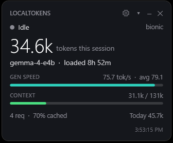

# LocalTokens

**See how hard your local LLMs are working.** LocalTokens is a small always-on window
and tray icon for Windows. It shows how many tokens your models in [LM Studio](https://lmstudio.ai)
process: this session, today, this week and all time, per model, and how fast they run.



- **Live.** It shows whether a model is reading a prompt or generating, with tokens per
  second as it happens. The tray icon shows the speed too.
- **Sessions that make sense.** A session restarts when you load a model or switch to
  another one, or, if you prefer, when the LM Studio server starts.
- **History.** It reads your existing LM Studio logs on first run, so your totals start
  from the oldest log you have, not from the day you installed it.
- **Per model.** For each model: tokens, generation speed, prompt speed, and how much of
  the prompt LM Studio served from its cache.
- **Themes.** Ten colour themes, some with a faint pixel-art background (Halloween,
  Space, Ocean, Cyberpunk), plus a light one. Or set your own accent colour.
- **Export.** Writes a CSV with one row per day and model, for a spreadsheet or your own charts.
- **Private.** It reads LM Studio's log files and asks LM Studio's local server
  (`127.0.0.1`) which models are loaded. Nothing is sent anywhere else.
- **Nothing to install.** Plain Windows PowerShell and WPF, both built into Windows. No
  Python, Node or installer.

## Requirements

- Windows 10 or 11
- LM Studio with its local server running. LocalTokens counts what that server logs:
  requests from apps, agents and scripts that use its API (`http://localhost:1234`).
  Chats in LM Studio's own chat window may not appear in those logs.

## Install

1. Download `LocalTokens-x.y.z.zip` from [Releases](../../releases).
2. Right-click the zip → **Properties** → tick **Unblock** → **OK**. Otherwise Windows
   asks for confirmation every time it starts.
3. Unzip it anywhere you like, for example `Documents\LocalTokens`.
4. Double-click **`LocalTokens.vbs`**.

The window appears in the top-right corner and an icon appears in the tray. On first
run it reads all your old LM Studio logs in the background. A few GB takes about a
minute, and the big number shows "reading logs NN%" until it's done.

To start it with Windows: tray icon → **Start with Windows**.

## What it shows

| | |
|---|---|
| **Status** | **Generating**, **Reading prompt NN%**, **Idle**, or **Server offline** |
| **Big number** | Tokens this session: new prompt tokens + generated tokens |
| **Model line** | The model in use, its quantization, and when the session began (`loaded 2h 10m`, `switched 12m`, `up 19h`). Hover for details |
| **GEN SPEED** | Tokens/s: live while generating, otherwise the last request's. `avg` is the session average. The bar turns yellow below `slowTps` |
| **CONTEXT** | The last request's context against the loaded context size |
| **Bottom line** | Requests this session, the share of prompt tokens served from LM Studio's cache, and tokens today |

The **▾** button opens the details:

- tokens per hour for the last 24 hours
- totals for the last 24 hours, today, the last 7 days and all time
- today's models with tokens and speed
- the last request's numbers
- what's loaded right now
- the log folders being read

**Tray icon:** the number is the current generation speed. The colour shows what the
server is doing: teal is generating, amber is reading a prompt, grey is idle. Left-click
shows or hides the window; right-click opens the menu.

## Themes

Tray icon → **Theme**:

| Theme | |
|---|---|
| **Auto** (default) | Halloween in October, Classic the rest of the year |
| Classic, OLED black, Midnight, Mocha, Forest | Dark palettes |
| Paper | Light |
| Halloween, Space, Ocean, Cyberpunk | Dark, with a pixel-art pattern tiled faintly over the background |

To use your own accent colour with any theme, set `"accent": "#FF6B9D"` in the settings file.
New themes are a few lines in `src\lib\theme.ps1`.

## Where the numbers come from

After every request, LM Studio's server writes a timing block to its log: prompt tokens,
generated tokens and how long each took. LocalTokens reads those lines.

LM Studio's logs are in `%USERPROFILE%\.lmstudio\server-logs`. Some setups write to
`%USERPROFILE%\.lmstudio\apps\<name>\server-logs` instead (for example `apps\bionic`),
and a computer can have both. LocalTokens finds and reads all of them, each separately,
and the window follows whichever server wrote last. Other folders can be added with `logDirs`.

**If the numbers stay at zero while you use a model:** your server logs may not include
the timing lines. Open a log file and search for `print_timing`. If it isn't there, raise
the server's log level in LM Studio's server/developer settings.

Generated tokens include reasoning ("thinking") tokens. A request cancelled before it
finishes isn't counted.

## Settings

Tray icon → **Edit settings file** opens `%APPDATA%\LocalTokens\config.json`. Changes apply
within a couple of seconds, without a restart. The common ones are also in the tray menu.

| Setting | Default | |
|---|---|---|
| `sessionMode` | `model` | `model`: a session restarts on a model load or switch. `server`: since the server started |
| `autoDetect` | `true` | Find LM Studio's log folders automatically |
| `logDirs` | `[]` | More server-logs folders to read, e.g. `["D:\\LMStudio\\server-logs"]` |
| `apiUrl` | `http://127.0.0.1:1234` | LM Studio's local server, used to list loaded models |
| `apiToken` | `""` | Only if your LM Studio API requires a token |
| `apiSeconds` | `30` | How often to ask which models are loaded. LM Studio logs each request, so keep it modest |
| `refreshSeconds` | `2` | How often the window redraws |
| `backfillDays` | `0` | First run: how many days of old logs to read. `0` reads all of them |
| `speedScale` | `80` | Tokens/s that fills the GEN SPEED bar |
| `slowTps` | `5` | Generation slower than this turns the bar yellow |
| `topModels` | `3` | Rows under MODELS TODAY |
| `theme` | `auto` | `auto`, `classic`, `oled`, `midnight`, `mocha`, `forest`, `paper`, `halloween`, `space`, `ocean`, `cyberpunk` |
| `accent` | `""` | Your own accent colour, `#RRGGBB` |
| `warnPercent` / `critPercent` | `60` / `85` | Context use that turns the bar yellow / red |
| `details`, `topmost`, `opacity`, `scale` | | Window options |

## Files it writes

- `%APPDATA%\LocalTokens\config.json`: settings
- `%LOCALAPPDATA%\LocalTokens\log-cache.txt`: totals and how far each log has been read.
  Delete it (or use **Re-read all logs**) to count everything again.
- `%LOCALAPPDATA%\LocalTokens\error.log`: errors, if any
- The Startup-folder shortcut, if you turn on **Start with Windows**

**Uninstall:** turn off **Start with Windows**, exit, and delete the LocalTokens folder and the two folders above.

## Troubleshooting

- **Nothing appears after double-clicking:** look in `%LOCALAPPDATA%\LocalTokens\error.log`.
  If the zip wasn't unblocked, unblock it (Install, step 2) and unzip again.
- **"Server offline"**: LM Studio's server isn't running, or it's on another address
  (set `apiUrl`).
- **"no LM Studio log folder found"**: LM Studio keeps its files somewhere else. Add the
  server-logs folder to `logDirs`.

## Development

```powershell
# run the tests (sample logs in tests\fixtures, no LM Studio needed)
powershell -ExecutionPolicy Bypass -File tests\Test-LocalTokens.ps1

# build the release zip into dist\
powershell -ExecutionPolicy Bypass -File tools\Package.ps1
```

| File | |
|---|---|
| `LocalTokens.vbs` | Starts the app without a console window |
| `src\LocalTokens.ps1` | Entry point: window, timers, events |
| `src\LogReader.cs` | The log reader (C#, compiled at start by PowerShell). It must stay C# 5, which is what Windows PowerShell 5.1 compiles |
| `src\window.xaml` | The window's layout and colours |
| `src\lib\config.ps1` | Settings |
| `src\lib\sources.ps1` | Finding log folders, the reader's lifecycle, LM Studio's API |
| `src\lib\view.ps1` | Drawing the window |
| `src\lib\theme.ps1` | Colour themes and background patterns |
| `src\lib\tray.ps1` | Tray icon, menu, CSV export, Start with Windows |

Pushing a tag like `v0.1.0` runs the tests and publishes a release with the zip
(`.github/workflows/release.yml`).

## Credits

The window and tray approach (PowerShell + WPF, a silent `.vbs` launcher, a tray icon
drawn at runtime) and the theme palettes and pixel patterns come from [clawd-usage-winwidget](https://github.com/Enhed/clawd-usage-winwidget)
by Venger Sergey, MIT licence.

LocalTokens is an independent project. It isn't affiliated with or endorsed by LM Studio.

## License

[MIT](LICENSE)
